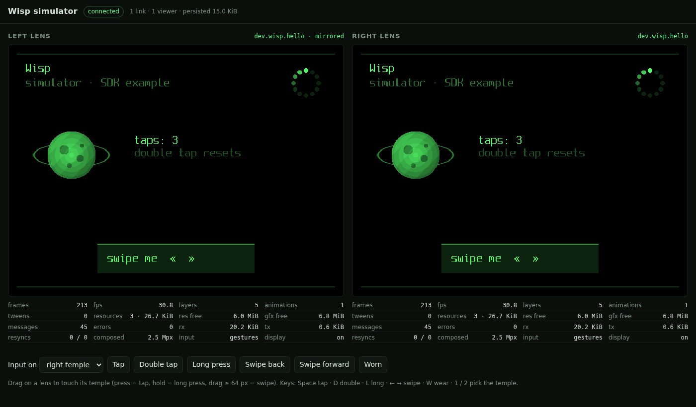

# wisp-sim

The [Wisp](../../docs/wisp/README.md) simulator: the real glasses-side core (`packages/wisp-core`, compiled to WebAssembly) behind a WebSocket link, with a browser viewer that shows both lenses, injects touch and gestures, toggles wear and shows stats. Apps and the SDK are built against it before anything is flashed.



## Run it

```sh
pnpm nx run wisp-sim:serve                       # viewer on http://127.0.0.1:8360/
node apps/wisp-sim/dist/examples/hello.js        # the SDK example, in a second terminal
```

`serve` builds first (the WebAssembly build needs `clang` with the wasm32 target and `wasm-ld`; on a Nix host they come from `nix shell` by themselves). Options: `node apps/wisp-sim/dist/src/main.js --port 8360 --host 127.0.0.1 --data <dir>`; with `--data`, persisted resources survive restarts.

An SDK connects with `WebSocketTransport.connect('ws://127.0.0.1:8360/link')`. Each binary WebSocket message carries a piece of the Wisp byte stream (frames, CRC, credits: exactly what BLE carries).

| Link URL          | Meaning                                                                                                                                             |
| ----------------- | --------------------------------------------------------------------------------------------------------------------------------------------------- |
| `/link`           | connected to the right temple; `route 0` goes to **both** lenses (the left one follows: its responses are dropped so every request gets one answer) |
| `/link?lens=left` | connected to the left temple instead                                                                                                                |
| `/link?mirror=0`  | `route 0` = only the connected lens; use `route` 1, 2 or 3 per frame for stereo, or open one link per temple                                        |

## Viewer

Both lenses at 640×480, 16 green levels, updated with dirty rects as the core presents them. Stats per lens: frames and fps, layers, animations, tweens, resources and pool space, messages and errors, link bytes, resyncs / resends, pixels composed, input mode, display power.

Input: press on a lens = finger on that temple (the core's gesture recognizer turns it into tap, double tap, long press; drag ≥ 64 px = swipe). Buttons and keys inject recognised gestures directly: Space tap, D double tap, L (hold) long press, ← → swipes, W toggles wear (with `DISPLAY_POWER off_when_unworn` the lens goes dark), 1 / 2 pick the temple.

HTTP API (tools and tests): `GET /api/stats`, `GET /api/frame?lens=1|2` (RAW4, 153 600 bytes), `POST /api/input` with `{"type":"gesture","lens":2,"kind":1}`, `{"type":"touch","lens":2,"phase":0,"pos":300}` or `{"type":"wear","worn":false}`.

## How it's built

```
 SDK app ──ws /link──▶ Node: server.ts ──▶ wisp-sim.wasm ──────────────────────────┐
 viewer  ◀─ws /viewer─ (http, ws, ticks,     sim.c: links (wisp_rx / wisp_tx,       │
          dirty rects, stats; input back)     credits, route), 2 × wisp_engine,      │
                                              framebuffers, storage → host imports   │
                                            wisp-core: session, display, resources,  │
                                              text, anim, input (the firmware's code)┘
```

- `src/c/sim.c` is the sim HAL: two `wisp_engine`s (one per lens), up to four links, a `present()` that writes into per-lens framebuffers and tracks damage, storage through imported host functions. It is plain C with no libc, so it's also a template for the firmware's link glue.
- `src/core.ts` loads the module and wraps its exports; `src/server.ts` serves the links, the viewer and the API, ticks the core every 4 ms (animations, tweens, gesture timers, session timeouts) and pushes damaged rects to viewers at most every 16 ms; `src/storage.ts` is the persistent store (LRU within `persist_bytes`, optionally mirrored to a directory).
- `viewer/` is a static page with no build step.

**Why WebAssembly in Node, not in the page or as a native addon.** The core is portable C with no libc, so `clang --target=wasm32` builds it with no toolchain beyond clang and lld (57 KB), and the same `.wasm` runs on Linux and macOS with no node-gyp, headers or per-platform binaries. Running it in the Node process rather than in the page means one simulated pair of glasses that any number of SDK clients and viewers share, headless end-to-end tests with no browser, and a viewer that is just a display; a page-only build would need the page open to have glasses at all, plus a relay. Compiling the core to wasm32 on every build also proves it stays portable, next to the Cortex-M55 build.

## Example

[`examples/hello.ts`](examples/hello.ts) uses only the public SDK: it bakes [Spleen](https://github.com/fcambus/spleen) 12×24 (BSD-2-Clause, Latin-1 subset in `examples/fonts/`) into a Wisp font with the SDK's `parseBdf` + `fontResource` and uploads it persisted (the next run skips the upload by hash), uploads a procedural image and a 12-frame animation, draws text, plays the animation on the glasses, slides a panel in with a tween, counts taps (double tap resets), and moves the panel with swipes.

## Tests

`pnpm nx run wisp-sim:test` starts the simulator in-process, runs the example headless against it and checks the composed frames: the image region equals the uploaded pixels exactly, the text is drawn, the tween ended where it should, the spinner animates by itself, the left lens mirrors the right, a simulated tap (raw touch through the recogniser) redraws the counter, a swipe moves the panel, no errors or resyncs, BYE ends both sessions, the persisted font is listed in the next session; plus the HTTP API.

`tools/screenshot.sh` renders `docs/viewer.png` with headless Chromium.

## Limits and notes

- Protocol 0.2 framing from `wisp-core`: `CREDIT` / `RESYNC` travel as unsequenced control frames, one coalesced `CREDIT` per received chunk, and `wisp_tx_tick` runs the ack timeout.
- Sensors: only wear (`SUBSCRIBE`/`READ` sensor 5). Audio, IMU and the update service answer "unsupported".
- One process, one pair of glasses. Up to four links at once.
